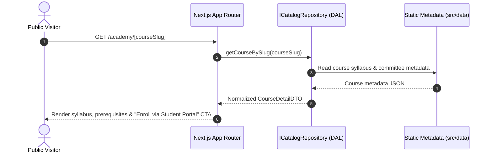
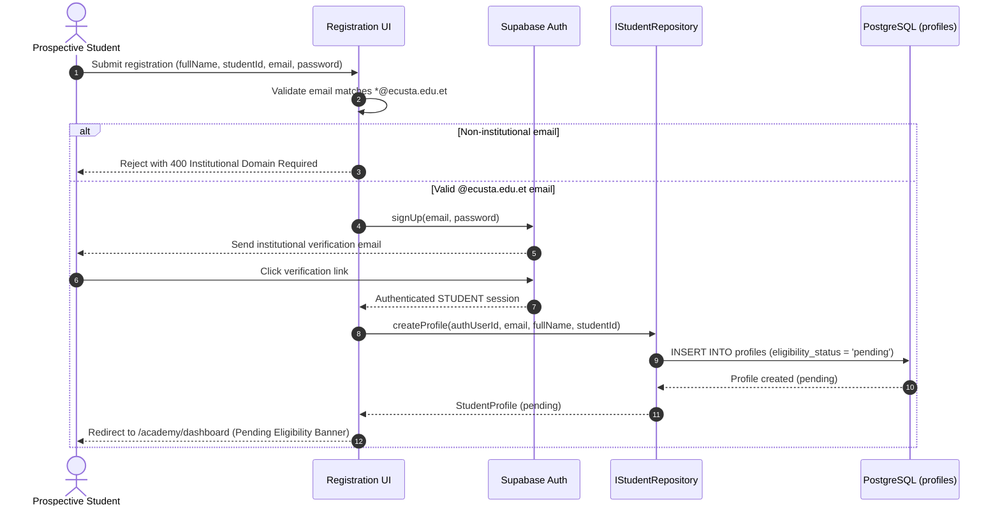
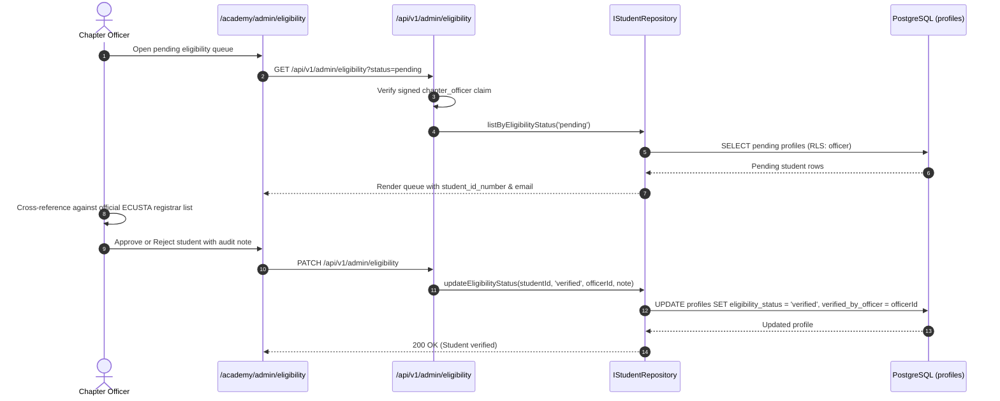
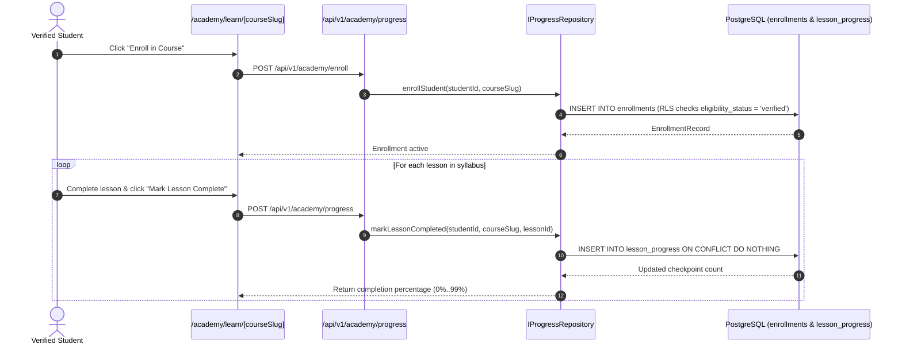
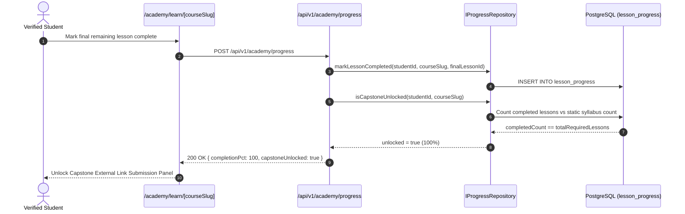
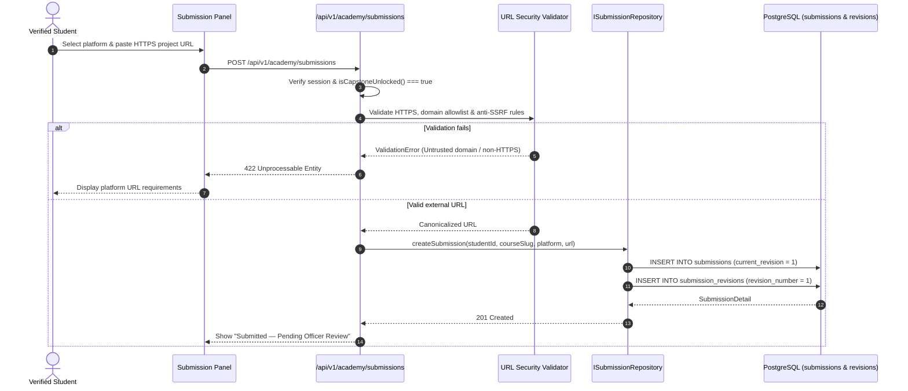
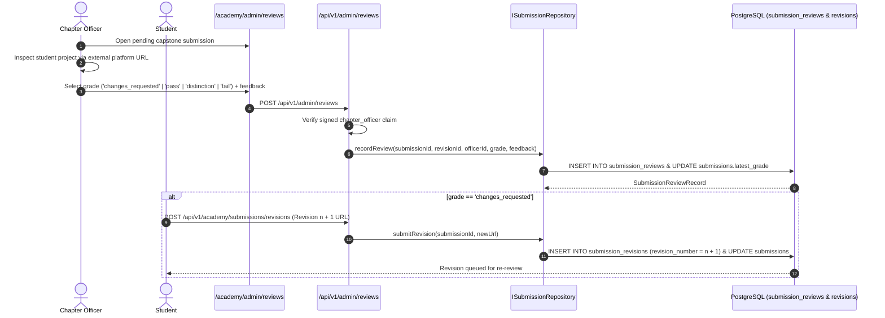
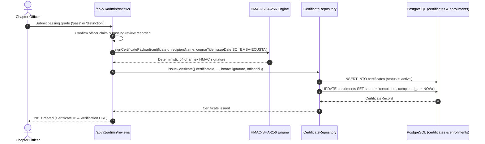
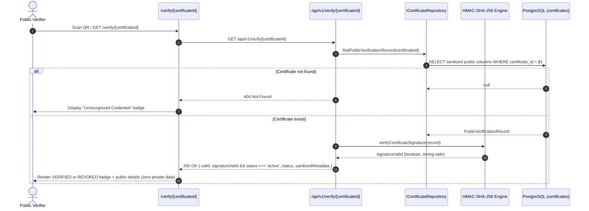
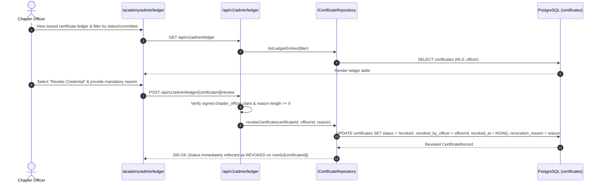

# 01 — EMSA Academy LMS Lifecycle Workflows

> **Document Scope:** End-to-end operational workflows and Mermaid sequence diagrams covering discovery, institutional domain gating, eligibility verification, progression, capstone submissions, grading, and cryptographic verification.

---

## 1. Public Visitor → Course Discovery

Unauthenticated visitors browse the EMSA Academy catalog and inspect full syllabus details sourced via the DAL from version-controlled course metadata (`src/data/`).

---

## 2. Student Registration → Institutional Domain Gate (`@ecusta.edu.et`)

Public sign-up exposes **only one account type (`STUDENT`)** and enforces the `@ecusta.edu.et` domain gate both in validation schemas and PostgreSQL `CHECK` constraints.

---

## 3. Student Eligibility Review (Manual Registrar Cross-Reference)

Chapter officers manually cross-reference newly registered student IDs and institutional emails against official registrar rosters before unlocking course enrollment.

---

## 4. Course Enrollment & Lesson Progress Checkpointing

Verified students enroll in standing-committee courses and record idempotent lesson completion checkpoints inside `/academy/learn/[courseSlug]`.

---

## 5. 100% Completion → Capstone Gate Unlock

The capstone project submission form remains locked until server-side verification confirms 100% of required lessons for the course slug are completed.

---

## 6. External Link Project Submission

Following the **Zero-Storage Policy**, the student submits an HTTPS link to an approved external platform (Google Drive, Canva, Figma, YouTube, or Other Approved).

---

## 7. Internal Review, Grading & Feedback

Chapter officers inspect submitted external links in `/academy/admin/reviews` and record immutable evaluations. If changes are requested, the student submits revision `n + 1`.

---

## 8. Passing Grade → Automated Certificate Generation

When an officer records a passing grade (`pass` or `distinction`), the backend deterministically computes the HMAC-SHA-256 certificate signature and seals the record in the ledger.

---

## 9. Public QR Code & URL Verification

Anyone (employers, residency boards, peers) can scan a certificate QR code or open `/verify/[certificateId]` with zero authentication to validate authenticity and revocation status.

---

## 10. Credential Revocation & Ledger Auditing

Chapter officers can audit all issued credentials and revoke compromised or erroneously issued certificates with a mandatory audit reason.

